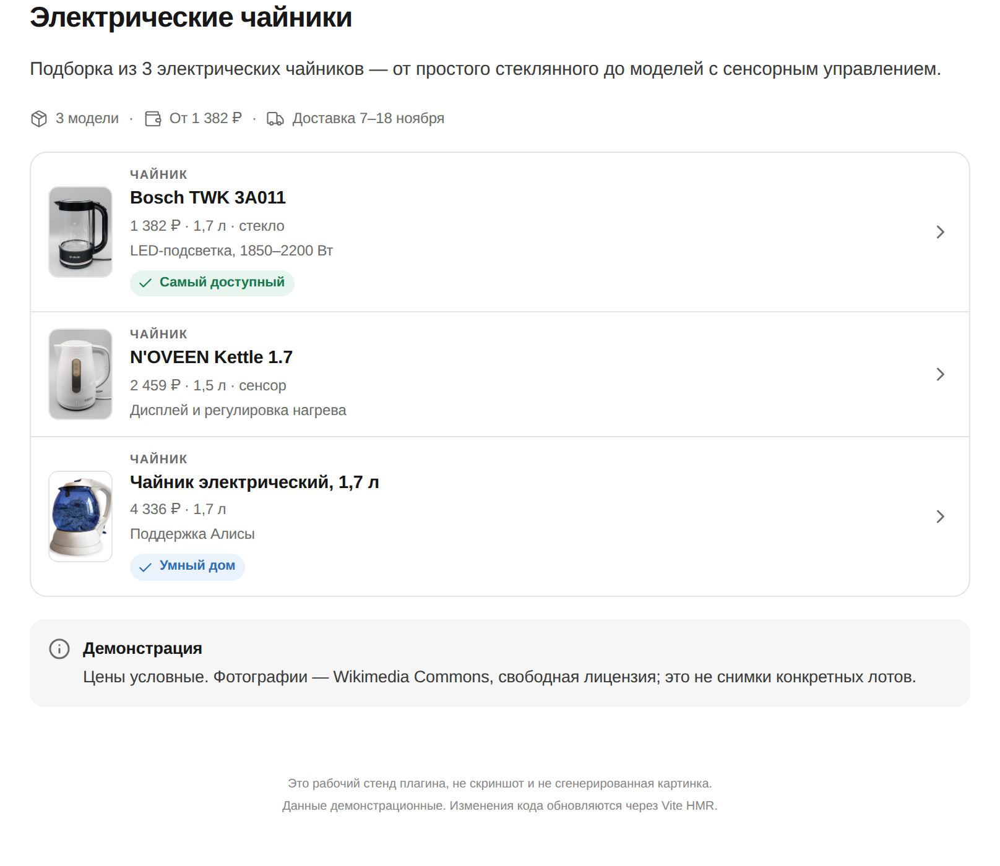
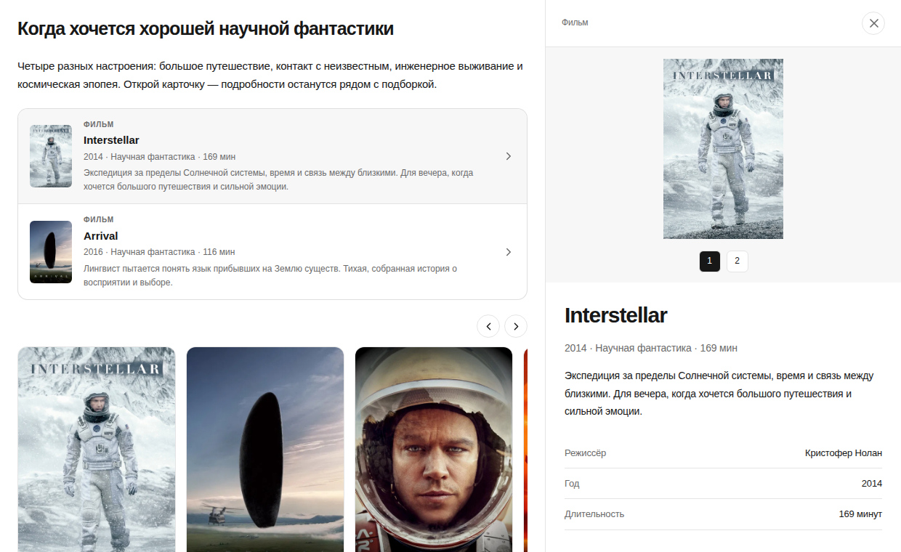
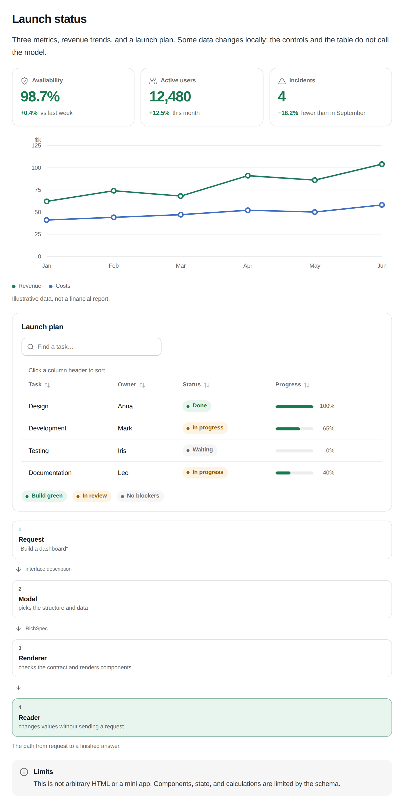
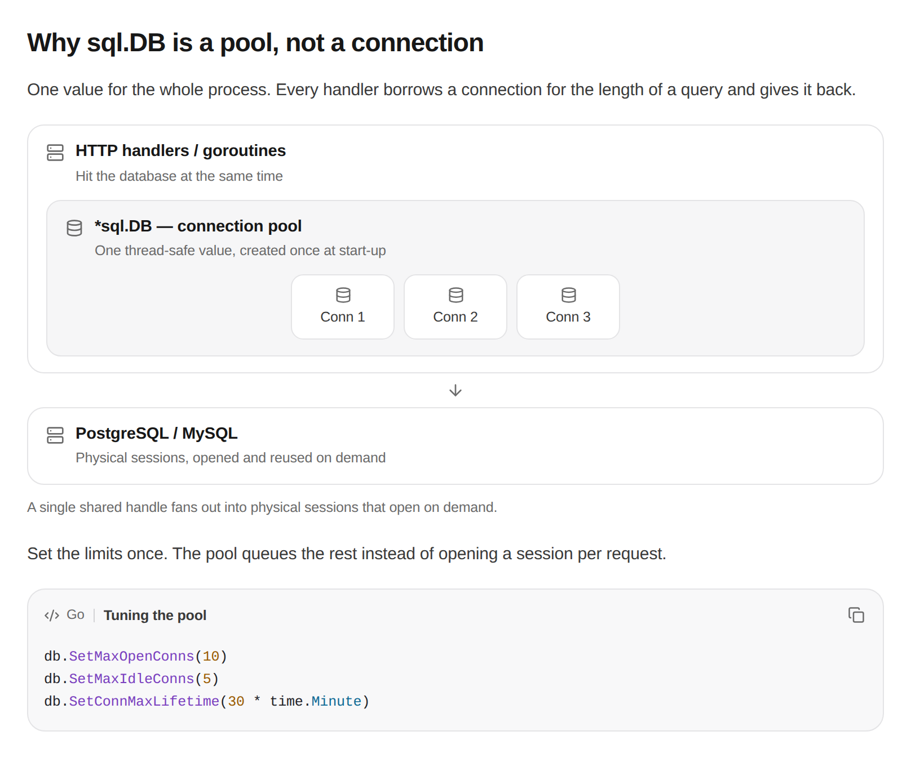
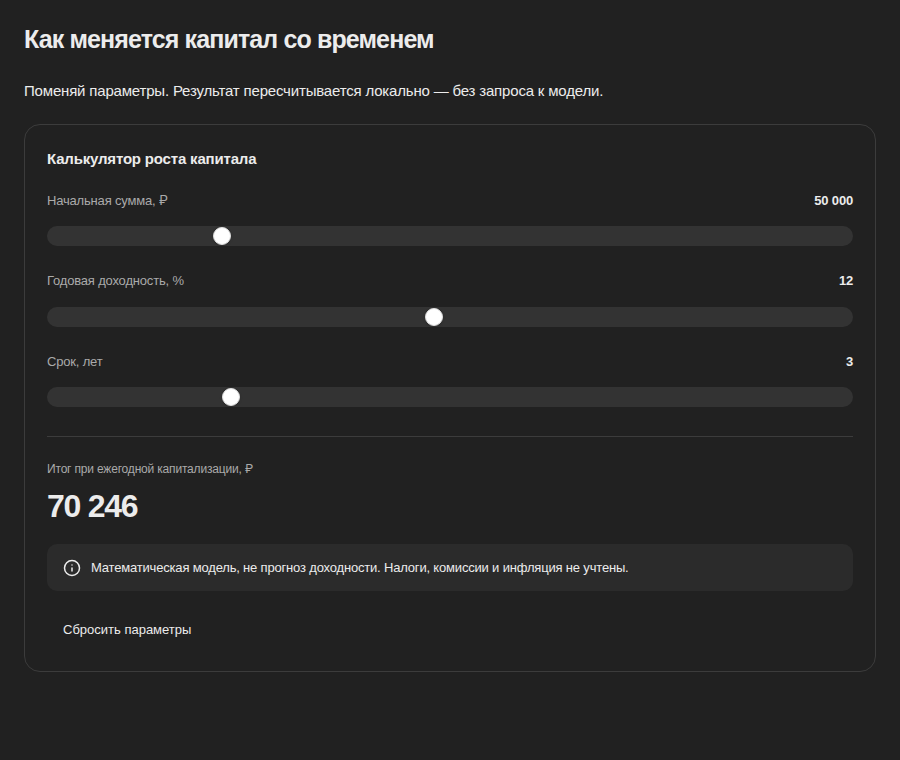
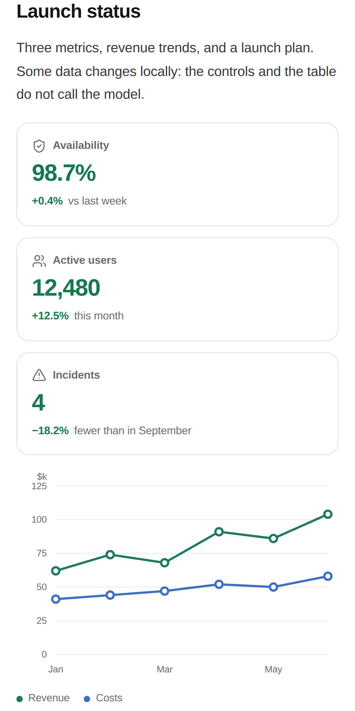
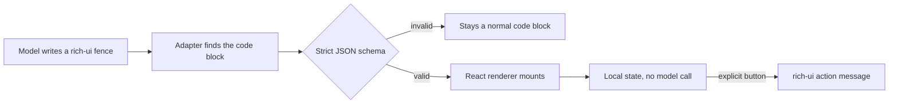
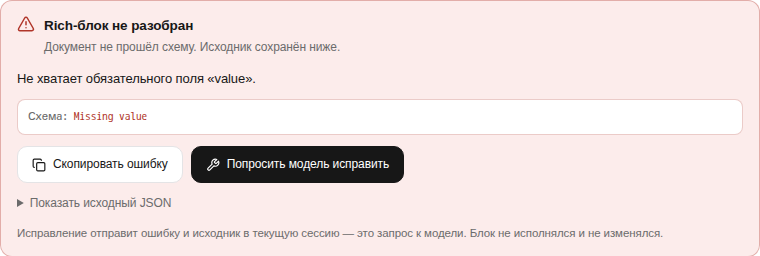

<div align="center">

# DSH Rich UI

**Answers that behave like an interface, not a wall of Markdown.**

Entity collections with detail panels, KPI cards, multi-series charts, sortable tables, flow and layered architecture diagrams, calculators that recompute as you drag — rendered inside [DeepSeek Harness](https://github.com/deepseek-ai/deepseek-harness) from a strict JSON contract.

[](https://github.com/kyoukisu/dsh-rich-ui/stargazers)
[](LICENSE)
[](https://github.com/kyoukisu/dsh-rich-ui/commits/main)

[](https://www.npmjs.com/package/@kyoukisu/dsh-rich-ui)

[Live demo](https://rich-ui.beako.best/) · [Install](#install) · [Quick start](#quick-start) · [Contract](prompt-rich-ui/prompt.md) · [Design notes](docs/PARITY.md) · [Safety](#safety)

</div>

<p align="center">
  <picture>
    <source media="(prefers-color-scheme: dark)" srcset="docs/images/listing-desktop-dark.png">
    
  </picture>
</p>

## What this is, and why

A model can describe a comparison, but a wall of Markdown makes the reader do the layout work. This plugin gives the model a small declarative language for the cases where structure carries the answer: side-by-side options, an object you want to inspect, a number the reader will change.

The renderer is a real React tree behind a strict schema. There is no generated HTML, no `eval`, no shell access, and no page-level JavaScript from the model. Local controls recompute in the browser; the model is only called again when the reader explicitly asks.

<p align="center">
  
  <br>
  <em>In the lab the answer reflows beside the open panel. In Harness the same entity opens as a native right-column tab, so the conversation narrows instead of being covered — see <a href="docs/DSH-INTEGRATION.md">the integration notes</a>.</em>
</p>

<p align="center">
  <picture>
    <source media="(prefers-color-scheme: dark)" srcset="docs/images/dashboard-desktop-dark.png">
    
  </picture>
  <br>
  <em>Metrics, a two-series chart with units and hover, a filterable table with status pills and an ordered flow — one document.</em>
</p>

<p align="center">
  
  <br>
  <em>Boxes inside boxes: the pool holds connections, the arrow shows what it talks to. The code block keeps language label, syntax colour and copy.</em>
</p>

<p align="center">
  
  <br>
  <em>Sliders recompute the number in the browser; the model is not called again.</em>
</p>

<p align="center">
  
  <br>
  <em>390 px: cards stack, the chart gets its own coordinate system, the table still fits.</em>
</p>

## Live demo

**[rich-ui.beako.best](https://rich-ui.beako.best/)** — the real renderer in laboratory conditions, no install. Scenarios: dashboard, films, listing, calculator, configurator, technical breakdown and the rejected-block diagnostic; add `&theme=dark` for the dark theme. Demo data is illustrative.

## Install

Requires DeepSeek Harness `0.2.x` and Node `22.19+`. No NixOS change, no patched Harness.

```sh
dsh plugin --profile web add @kyoukisu/dsh-rich-ui
systemctl --user restart deepseek-harness   # or restart however your Harness runs
```

From a checkout — this is the loop the author uses:

```sh
git clone https://github.com/kyoukisu/dsh-rich-ui && cd dsh-rich-ui
npm ci && npm run build:plugin
dsh plugin --profile web add link:$PWD
```

Unreleased commits: `dsh plugin --profile web add github:kyoukisu/dsh-rich-ui`.

The plugin registers itself as a bundle; the fence language is `rich-ui`.

## Quick start

Ask for something that benefits from structure, in a new session:

```text
Compare three electric kettles by price, volume and features. Make it clickable.
```

The reply arrives as an interface: a summary strip, rows with photos, and a green highlight on the cheapest option. Opening a row shows facts, sources and related items without leaving the conversation.

Things worth trying: *"build a budget calculator with three sliders"*, *"show this quarter as a chart and a table"*, *"make a configurator with tabs and conditional warnings"*.

## What it can render

| Group | Nodes |
|---|---|
| Layout | `stack`, `row`, `grid`, `card`, `divider`, `meta` |
| Text | `text` with inline `code`, **bold**, links and `[[entityId]]` chips; `callout` with optional title; `code` with syntax colour, language label, line numbers and copy |
| Objects | `entity-ref`, ``entity-list` with poster or square row thumbnails; entity details dock in the native right column or fall back to an in-page drawer |
| Data | `stat` (KPI card), `progress`, `status`, `table` (sortable, filterable, status and progress columns), `chart` (bar / line / area / donut, 1–6 series, units, tooltips), `computed` |
| Flow | `diagram` with ordered steps, connector labels and branch depth; `layers` for boxes-inside-boxes architecture with member chips |
| Media | `image`, `image-group`, gallery lightbox, popover, tooltip |
| Controls | `input` (text / number / date), `select`, `slider`, `switch`, `checkbox`, `radio`, `segmented`, `tabs` |
| Logic | expressions (`add`, `mul`, `round`, comparisons…), `conditional`, local actions, `send-message` |

Roughly 150 Lucide icons resolve by name, with semantic tones (`success`, `warning`, `danger`, `muted`) so colour means something. Light and dark themes follow the host palette and font.

## The contract in ten lines

````text
```rich-ui
{"version":1,"title":"Budget","initialState":{"spend":1200},
 "nodes":[
  {"type":"slider","stateKey":"spend","label":"Monthly spend, €","min":100,"max":5000,"step":100},
  {"type":"computed","label":"Per year, €","expr":{"op":"mul","args":[{"state":"spend"},12]}},
  {"type":"callout","tone":"info","content":"Recomputed locally — no model call."}
 ]}
```
````

<details>
<summary>Entities, tables, charts and actions — one complete document</summary>

```json
{"version":1,"title":"Films for tonight",
 "entities":[{"id":"a","kind":"Film","title":"Arrival","subtitle":"2016 · science fiction",
   "image":"https://example.org/poster.jpg",
   "facts":[{"label":"Director","value":"Denis Villeneuve"}],
   "sources":[{"title":"TMDB","url":"https://www.themoviedb.org/movie/329865-arrival"}],
   "badge":{"label":"Editors' pick","tone":"success"}}],
 "nodes":[
  {"type":"meta","items":[{"icon":"film","text":"3 films"},{"icon":"clock","text":"2 hours"}]},
  {"type":"entity-list","entityIds":["a"]},
  {"type":"table","columns":[{"key":"k","label":"What"},{"key":"v","label":"How many"}],
   "rows":[{"k":"Screenings","v":3}]},
  {"type":"chart","kind":"bar","data":[{"label":"Mon","value":2},{"label":"Tue","value":5}]}]}
```

</details>

The authoritative text is [prompt-rich-ui/prompt.md](prompt-rich-ui/prompt.md); exact fields, enums and budgets live in [references/schema.md](prompt-rich-ui/references/schema.md), and working documents in [references/examples.md](prompt-rich-ui/references/examples.md).

## How it works



- **Node half** registers one always-on system-prompt section with the whole contract and the absolute path of the reference files. No skill, no tool call: the model can answer on the first attempt, and opens references only after a rejected block.
- **Browser half** validates the fence and mounts into a plugin-owned root. While the model is still writing, closed nodes render in an inert preview and become interactive when the block settles.
- Malformed documents are never repaired silently: a claimed block shows a diagnostic card with the exact error, the rejected JSON and a one-click request for a corrected block. Unfinished streams stay code until the model closes them.

## Safety

| Risk | Mitigation |
|---|---|
| Arbitrary code execution | Declarative JSON only; no HTML, CSS, JS, `eval` or property paths |
| Prompt-injected actions | Local actions cannot call tools; `send-message` needs an explicit click and is delivered as ordinary user text |
| Secrets in the UI | Password/secret state keys are rejected; no secret input components exist |
| Hostile URLs | `http(s)` only, credentials in URLs rejected |
| Resource exhaustion | Bounded depth, node count, string size and expression budget |
| Stored data | Persistence is opt-in, per session, and never stores text or date inputs |

## Parity with the reference

Measured, not claimed: **17 of 27** reference scenarios reproduced, **2 partial**, **8 missing** — with an itemised deviation list in [docs/PARITY.md](docs/PARITY.md). Missing today: automatic same-turn repair, scatter plots, Mermaid/ER graphs, math, maps, media, artifacts, persistent panels and mini-apps.

Known limitation: the fence label is not preserved by Harness, so an unlabelled block is claimed only when its payload looks like a spec document and passes the strict parser. A `json`-labelled block is never claimed.

## Troubleshooting

**The block stayed as code.** The JSON did not pass the schema — usually an unknown field (`title` inside a node that has none, or `items` from another plugin's syntax). A claimed fence now shows the exact error, the rejected source and a button that sends both back to the model for a corrected block. Nothing is repaired or executed silently.

<p align="center">
  <picture>
    <source media="(prefers-color-scheme: dark)" srcset="docs/images/diagnostic-dark.png">
    
  </picture>
  <br>
  <em>A rejected block explains itself and offers a one-click repair request instead of raw JSON.</em>
</p>


**Images show a placeholder.** The URL is wrong, blocked by the remote host, or not `http(s)`. Ozon/WB CDNs reject hotlinks; use a permitted source or your own media host.

**Old `dsh-ui` messages stopped rendering.** That is a different plugin's syntax. This one claims `rich-ui` only.

## Development

```sh
npm ci
npm run dev            # lab at http://127.0.0.1:4173, HMR, no Harness needed
npm run build          # typecheck + lab build
npm run build:plugin   # the two real bundle artifacts
npm test               # 121 unit, schema and DOM tests
npm run test:browser   # Playwright desktop + mobile (goldens never auto-update)
```

Browser tests run in a pinned container so no system libraries are required:

```sh
docker run --rm --network host --ipc host --user "$(id -u):$(id -g)" \
  -e HOME=/tmp -v "$PWD:/work" -w /work \
  mcr.microsoft.com/playwright:v1.64.1-noble npx playwright test
```

Scenarios in the lab: `?demo=dashboard`, `films`, `listing`, `calculator`, `configurator`, `technical`, `primitives`, plus `&theme=dark`.

Screenshots in this README are captures of that lab, not mockups. Golden images under `tests/` are regression baselines and say nothing about fidelity to another product.

## License

MIT — see [LICENSE](LICENSE). Demo photography comes from Wikimedia Commons under free licences; prices and metadata are illustrative. DeepSeek Harness is a separate project by DeepSeek; this plugin is unaffiliated.
